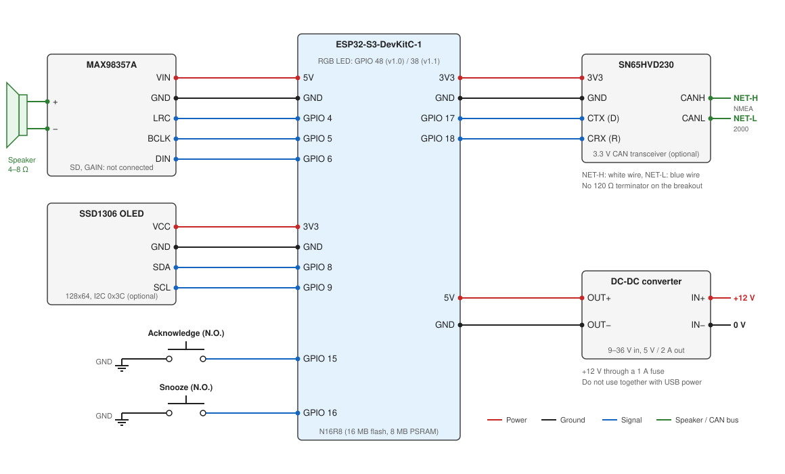

# Step 1: Assemble the hardware

Do all the wiring with the board **unpowered**: USB cable unplugged and no 12 V connected.

This page lists every part and every connection, so that the device can be rebuilt exactly. The amplifier and the speaker are needed for the device to speak; the CAN transceiver and the display are optional, and the firmware runs without them.

## Wiring diagram

The diagram shows one wire per connection. The board has several GND pins and they are all the same net: use whichever is closest. The steps below go through the diagram module by module, and the [connection list](#connection-list) at the end of the page has every wire in one table.

## 1.1 Collect the parts

| Part | Notes |
|------|-------|
| ESP32-S3-DevKitC-1 **N16R8** | 16 MB flash and 8 MB PSRAM are both required: the firmware is about 8.3 MB and the speech engine needs about 1.1 MB of PSRAM. Other variants of the board will not work. |
| MAX98357A I2S amplifier breakout | Mono, 3 W class D, with the pins VIN, GND, SD, GAIN, DIN, BCLK and LRC. |
| Speaker | 4 or 8 Ω, 3 W or more. |
| CAN transceiver breakout | A 3.3 V type such as SN65HVD230. Only needed if you want the NMEA 2000 fallback. Do not use a 5 V transceiver (MCP2551, TJA1050): its output would put 5 V on a GPIO. |
| 2 momentary push buttons | Normally open. |
| SSD1306 OLED display | Optional. A 0.96" 128x64 I2C module with four pins (GND, VCC, SCL, SDA). |
| USB cable | A data cable that fits the board, for flashing. |
| Breadboard and jumper wires | Or solder the connections for a permanent installation. |
| 12 V to 5 V DC-DC converter | For powering the device on board, once everything works. A step-down (buck) module with a regulated 5 V output of 2 A or more. |
| Fuse holder and 1 A fuse | For the 12 V supply wire. |
| Electrolytic capacitor, 470 µF or more, 10 V | Optional. Across the amplifier's VIN and GND, if the device restarts or the sound crackles at high volume. |

## 1.2 Wire the amplifier

| Amplifier pin | Connect to |
|---------------|-----------|
| VIN | 5 V pin of the board |
| GND | GND |
| LRC | GPIO 4 |
| BCLK | GPIO 5 |
| DIN | GPIO 6 |
| SD, GAIN | Leave unconnected |

Then connect the speaker to the amplifier's **+** and **−** terminals.

- Both speaker terminals are driven by the amplifier. Connect neither of them to GND, and do not share them with another amplifier.
- With GAIN unconnected the amplifier's gain is 9 dB. The volume is set in the web interface.
- With SD unconnected, the breakout's own pull-up resistor keeps the amplifier switched on. The firmware sends the same signal on the left and the right channel, so the channel the amplifier picks does not matter.
- The amplifier is the largest load, drawing short peaks of several hundred milliamperes from the 5 V pin at full volume. Keep its VIN and GND wires short.

## 1.3 Wire the two buttons

Wire each button between its GPIO and GND. No resistor is needed; the board's internal pull-ups are used. A pin reads high when its button is released and low when it is pressed, and the firmware debounces it for 20 ms.

| Button | Connect between |
|--------|----------------|
| Acknowledge | GPIO 15 and GND |
| Snooze | GPIO 16 and GND |

## 1.4 Wire the CAN transceiver

Skip this step if you will only use Signal K over WiFi.

| Transceiver pin | Connect to |
|-----------------|-----------|
| 3V3 | 3.3 V pin of the board |
| GND | GND |
| CTX (also marked D or TX) | GPIO 17 |
| CRX (also marked R or RX) | GPIO 18 |
| CANH | NMEA 2000 CAN-H (white wire) |
| CANL | NMEA 2000 CAN-L (blue wire) |

1. If the breakout has a 120 Ω termination resistor, remove it. An NMEA 2000 backbone is already terminated at both ends.
2. Connect to the bus with a drop cable on a T-piece. You can leave the bus unconnected until the device works on the bench.

The device only listens on the bus. It does not claim an address and sends nothing.

The bus runs at 250 kbit/s. On an NMEA 2000 (DeviceNet Micro-C) drop cable the five conductors are:

| Pin | Name | Wire colour | Connect to |
|-----|------|-------------|-----------|
| 1 | Shield | Bare | Nothing |
| 2 | NET-S (+12 V) | Red | See [Power the device](#power-the-device) |
| 3 | NET-C (0 V) | Black | GND of the device |
| 4 | NET-H | White | CANH of the transceiver |
| 5 | NET-L | Blue | CANL of the transceiver |

The transceiver needs the bus's 0 V as its reference, so NET-C must be connected to the device's GND, unless the device is powered from the same battery negative that feeds the bus, in which case that connection already exists.

## 1.5 Wire the display

Skip this step if you do not want a display. The device detects whether one is connected, at startup and every ten seconds after that, and works the same without it.

| Display pin | Connect to |
|-------------|-----------|
| VCC | 3.3 V pin of the board |
| GND | GND |
| SDA | GPIO 8 |
| SCL | GPIO 9 |

The order of the pins differs between modules: go by the labels printed on yours, not by their position.

Most modules answer at the I2C address 0x3C, which is the default. If yours is set to 0x3D, change `OLED_I2C_ADDRESS` in `platformio.ini`.

The bus runs at 400 kHz. The module's own pull-up resistors on SDA and SCL are used; add none. Keep the wires shorter than about 20 cm.

## 1.6 Check the wiring

Before applying power, check that:

- nothing connects 5 V or 3.3 V directly to GND,
- the amplifier is on the **5 V** pin, and the CAN transceiver and the display on the **3.3 V** pin,
- every module shares GND with the board,
- neither speaker wire touches GND.

## 1.7 Power the device

On the bench, power the board from USB through either of its USB sockets. This is all that is needed for steps 2 to 4.

For the installation on board, power it from the boat's 12 V supply through the DC-DC converter:

| From | To |
|------|----|
| +12 V | Converter IN+, through the 1 A fuse placed close to the 12 V source |
| 0 V (battery negative) | Converter IN− |
| Converter OUT+ | 5 V pin of the board |
| Converter OUT− | GND of the board |

1. If the converter's output is adjustable, set it to 5.0 V with a multimeter **before** connecting it to the board. More than 5.5 V damages the amplifier and the board.
2. Do not connect the converter and a USB cable at the same time. Disconnect the converter's output before plugging the board into a computer.
3. The 12 V can be taken from the NMEA 2000 drop cable (NET-S red, NET-C black) or from any fused 12 V circuit. On a 24 V boat, use a converter rated for that input.

The 3.3 V pin of the board is an output of its own regulator. It supplies the CAN transceiver and the display; never feed it from outside.

## Connection list

Every wire of the complete device:

| From | To | Net |
|------|----|-----|
| Amplifier VIN | Board 5V | 5 V |
| Amplifier GND | Board GND | GND |
| Amplifier LRC | Board GPIO 4 | I2S word select |
| Amplifier BCLK | Board GPIO 5 | I2S bit clock |
| Amplifier DIN | Board GPIO 6 | I2S data |
| Amplifier + | Speaker + | Speaker |
| Amplifier − | Speaker − | Speaker |
| Acknowledge button, one side | Board GPIO 15 | Button, low when pressed |
| Acknowledge button, other side | Board GND | GND |
| Snooze button, one side | Board GPIO 16 | Button, low when pressed |
| Snooze button, other side | Board GND | GND |
| Transceiver 3V3 | Board 3V3 | 3.3 V |
| Transceiver GND | Board GND | GND |
| Transceiver CTX | Board GPIO 17 | CAN transmit (unused: the device only listens) |
| Transceiver CRX | Board GPIO 18 | CAN receive |
| Transceiver CANH | NMEA 2000 NET-H (white) | CAN bus |
| Transceiver CANL | NMEA 2000 NET-L (blue) | CAN bus |
| Display VCC | Board 3V3 | 3.3 V |
| Display GND | Board GND | GND |
| Display SDA | Board GPIO 8 | I2C data |
| Display SCL | Board GPIO 9 | I2C clock |
| Converter OUT+ | Board 5V | 5 V |
| Converter OUT− | Board GND | GND |
| Converter IN+ | +12 V, through a 1 A fuse | Supply |
| Converter IN− | 0 V, and NMEA 2000 NET-C (black) | Supply |

The amplifier's SD and GAIN pins and all the other pins of the board stay unconnected.

## Pin summary

The pins are set as build flags in the `[esp32s3]` section of `platformio.ini`. If your wiring differs, change them there before building in step 2.

| Function | Build flag | GPIO |
|----------|-----------|------|
| Amplifier LRC (word select) | `MAX98357A_LRC_PIN` | 4 |
| Amplifier BCLK | `MAX98357A_BCLK_PIN` | 5 |
| Amplifier DIN | `MAX98357A_DIN_PIN` | 6 |
| CAN transceiver TX | `N2K_CAN_TX_PIN` | 17 |
| CAN transceiver RX | `N2K_CAN_RX_PIN` | 18 |
| Acknowledge button | `ACK_BUTTON_PIN` | 15 |
| Snooze button | `SNOOZE_BUTTON_PIN` | 16 |
| Display SDA | `OLED_SDA_PIN` | 8 |
| Display SCL | `OLED_SCL_PIN` | 9 |
| On-board RGB LED | `PIN_RGB_LED` | 48 |
| On-board BOOT button | `BUTTON_BUILTIN` | 0 |

The on-board RGB LED is on GPIO 48 on DevKitC-1 v1.0 boards and on GPIO 38 on v1.1 boards (the version is printed on the board). On a v1.1 board, change `PIN_RGB_LED` to 38.

On the N16R8 module GPIO 35, 36 and 37 are used by the PSRAM, GPIO 19 and 20 by the USB socket and GPIO 0, 3, 45 and 46 are strapping pins: do not move a function to any of these.

Next: [Step 2: Install the software and flash the firmware](building).
